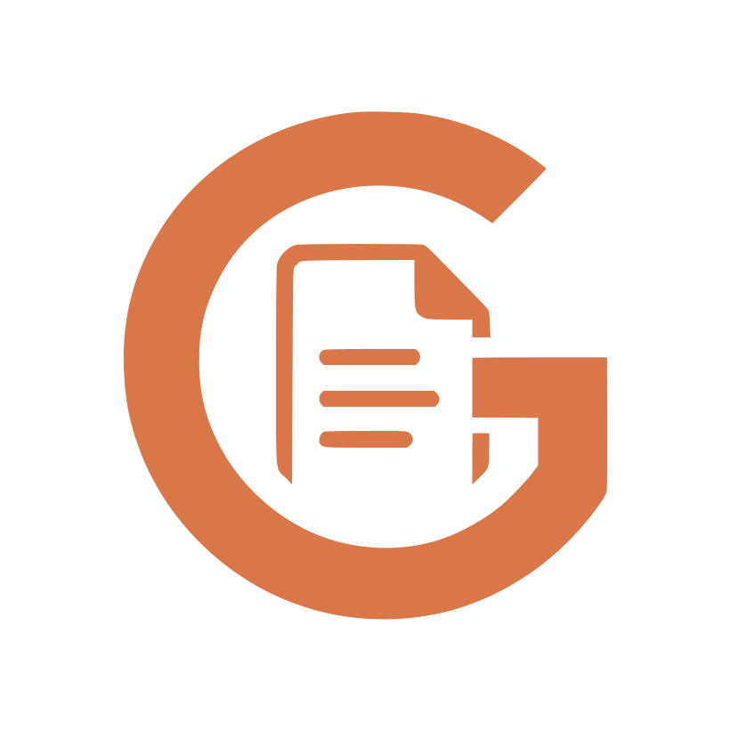
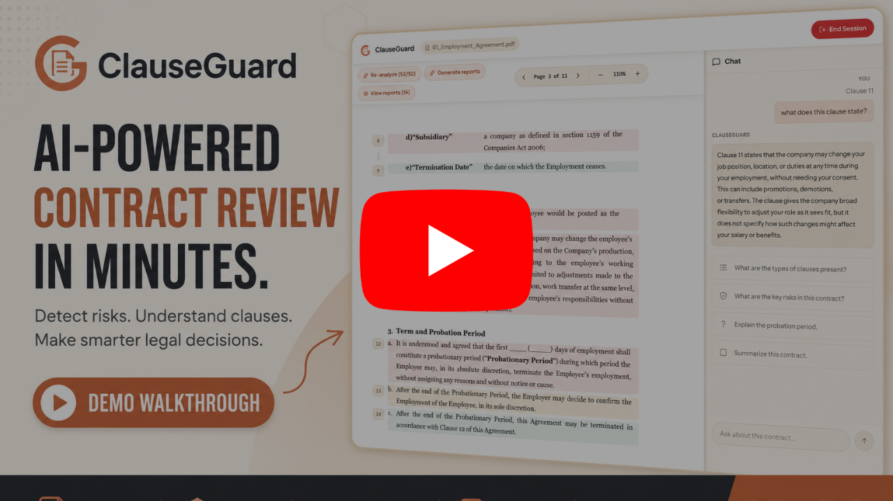
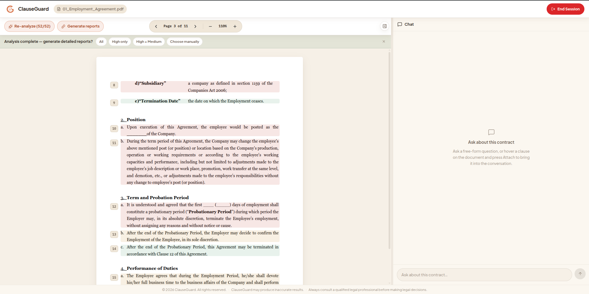

  

  # ClauseGuard

  **AI-powered legal contract review — explainable, clause by clause.**

  
  
  
  
  
  

## Demo

  
   
  <a href="https://www.youtube.com/watch?v=t1wdO2IBGTY"><strong>▶ Watch the demo</strong></a>

ClauseGuard is an AI-powered legal contract review platform. It helps
someone without legal training understand a contract, clause by clause,
in plain language.

It combines three things: a fine-tuned clause classifier, a deterministic
risk engine, and an LLM (Large Language Model) that generates reports
using RAG (Retrieval-Augmented Generation) — meaning it retrieves
relevant passages from the document before writing an answer, instead of
relying only on its training data. Every generated report cites the
specific passages it used.

ClauseGuard is not a lawyer replacement. It is an explainability layer.
Every risk flag traces back to a fixed rule. Every AI report traces back
to a specific clause and the context retrieved for it. Every
classification carries a calibrated confidence score, not a bare label.

  
   
  Every clause classified and color-coded by risk the moment analysis finishes. Full walkthrough in <a href="docs/GALLERY.md">docs/GALLERY.md</a>.

## What it does

1. **Upload** a contract as a PDF. ClauseGuard parses it and segments it
   into clauses. Each clause is anchored to its exact position on the
   page.
2. **Classify** every clause into one of 41 categories, derived from
   CUAD (the Contract Understanding Atticus Dataset). A fine-tuned
   Legal-BERT model does the classification. Each result carries a
   calibrated confidence score, with a low-confidence flag when
   appropriate.
3. **Assess risk** for each clause using a deterministic rule table. No
   LLM is involved in risk scoring. This keeps risk levels reproducible
   and auditable — the same input always produces the same risk level.
4. **Generate a report** for any clause, on demand. Each report includes
   a plain-language summary, the legal effect, concrete risks, and
   specific negotiation points. The report is grounded in supporting
   context retrieved from the rest of the document.
5. **Chat** about the contract through an LLM agent. The agent can look
   up clauses and generate reports on its own. For anything expensive,
   like a full-document analysis, it pauses and asks for confirmation
   before proceeding.

See [`docs/PIPELINE.md`](docs/PIPELINE.md) for the full clause-analysis
flow, [`docs/AGENT.md`](docs/AGENT.md) for the chat/agent layer,
[`docs/ML.md`](docs/ML.md) for the classifier,
[`docs/DEPLOYMENT.md`](docs/DEPLOYMENT.md) for the CI/CD pipeline and
self-hosted infrastructure, and [`docs/GALLERY.md`](docs/GALLERY.md) for a
full screenshot walkthrough.

## Architecture at a glance

- **Backend** — FastAPI. Routes stay thin; a service layer owns all
  business logic. The LLM and embedding-model vendors sit behind a
  provider abstraction, so switching vendors is a config change, not a
  code change.
- **ML** — Legal-BERT, fine-tuned on CUAD, classifies each clause into
  one of 41 categories. Classification runs locally. A separate
  embedding model handles retrieval.
- **Agent** — A LangGraph tool-calling loop, running on Groq. Real
  interrupt/resume human-in-the-loop confirmation gates any consequential
  action.
- **Retrieval** — A ChromaDB vector index, scoped to each session.
- **Frontend** — React and TypeScript. A desktop-first document workspace:
  a PDF viewer with clause overlays, a docked chat sidebar, and a report
  panel.
- **Deployment** — Self-hosted, using Docker Compose. GitHub Actions runs
  CI/CD: it builds multi-platform images, pushes them to GHCR (GitHub
  Container Registry), then deploys over a Tailscale-authenticated
  connection. A separate n8n workflow, on its own AWS host, monitors the
  live application independently.

Full breakdown in [`docs/ARCHITECTURE.md`](docs/ARCHITECTURE.md) and
[`docs/DEPLOYMENT.md`](docs/DEPLOYMENT.md).

## Tech stack

| Layer | Tools |
|---|---|
| Backend | FastAPI, Pydantic, uv |
| ML | Transformers, PyTorch (Legal-BERT), scikit-learn, sentence-transformers |
| Agent / LLM | LangChain, LangGraph, Groq |
| Retrieval | ChromaDB |
| Frontend | React, TypeScript, Vite |
| PDF | PyMuPDF (backend parsing), jsPDF (client-side report export) |

## Status

Actively developed. Classifier is on its second iteration (macro-F1 0.78,
up from 0.63) after a root-cause fix to a training-label conflict — see
[`docs/ML.md`](docs/ML.md) for that writeup. This repository is a public,
documentation-focused mirror; application source lives in a private
companion repository.

## License

See [`LICENSE`](LICENSE).
