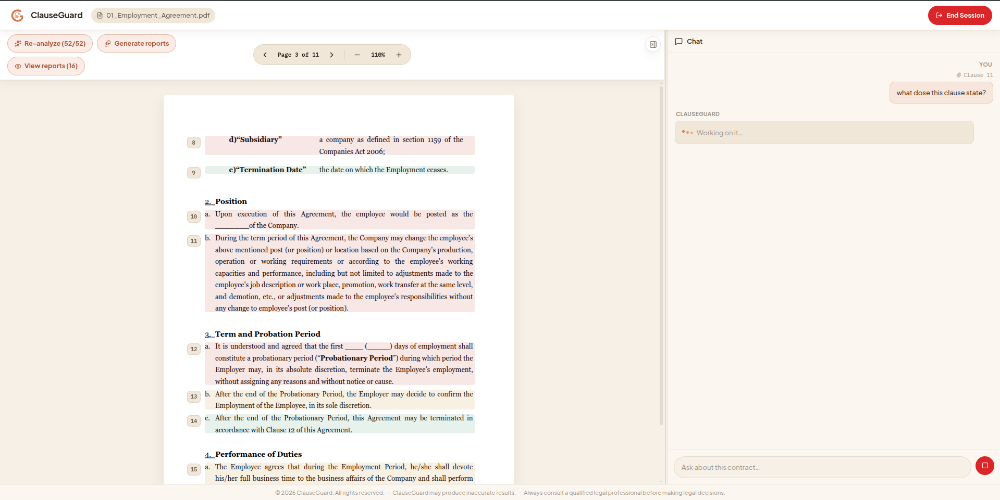
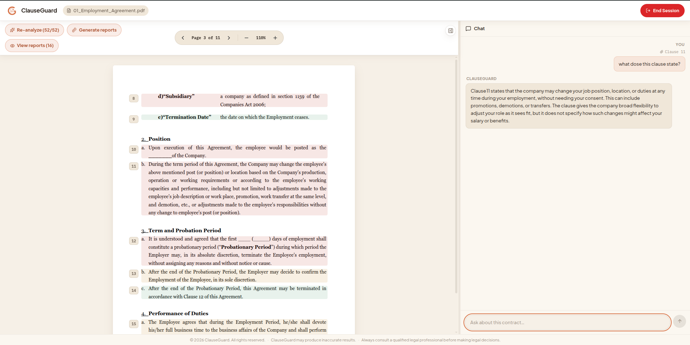
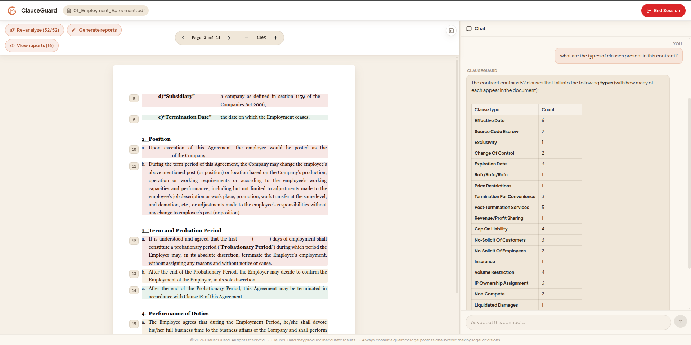
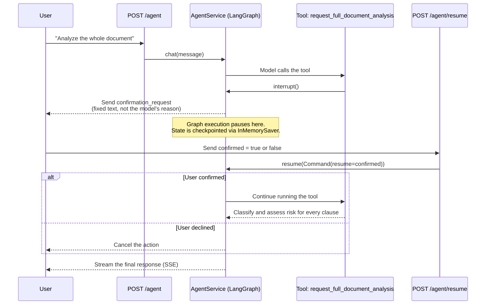

# Agent & Chat

ClauseGuard has two conversational surfaces over the same document: a
plain retrieval-augmented **chat** endpoint, and a tool-calling **agent**
built on LangGraph. The chat endpoint only answers questions. The agent
can take actions — look up a clause, generate a report, trigger a
full-document analysis.

## Why a separate agent layer

The chat endpoint (`ChatService`) does retrieval-augmented Q&A. RAG
(Retrieval-Augmented Generation) means the system retrieves relevant
context before generating an answer, instead of relying only on the
model's training data. The steps are: embed the question, pull matching
context from ChromaDB, then answer using that context plus the
conversation history. The chat endpoint never calls tools. It doesn't
need to.

The agent (`AgentService`) handles anything that requires the model to
*act* — for example: "show me clause 4," "run a full risk report,"
"compare clauses 1 and 2." Acting requires tool-calling: the model must
choose a tool, call it with the right arguments, and use the result.

Tool-calling reliability turned out to depend heavily on which specific
model is used — not just on model size or general quality. Because of
this, `AGENT_LLM_MODEL` (the model used by the agent) is configured
separately from `LLM_MODEL` (the model used for chat and report
generation). Only the agent path pays for a model that reliably supports
clean JSON tool-calling.

## Tools

The agent's tool set (`app/services/agent_tools.py`) is built fresh for
each session, and bound to that session's own workspace:

| Tool | Purpose |
|---|---|
| `find_clause_by_number` | Look up a specific clause by its number. |
| `list_clauses` | List clauses, optionally filtered by type or risk level. Also returns an exact risk-level count (see below). |
| `search_clauses` | Search the document's clauses by meaning, not exact text. |
| `load_report` | Fetch a clause's cached report, if one already exists. |
| `analyze_clauses` | Generate reports for a specific set of clause IDs. |
| `analyze_raw_text` | Analyze text the user pastes directly into chat, even if it isn't part of the uploaded document. |
| `request_full_document_analysis` | Classify and assess risk for every clause at once. Requires human confirmation first — see below. |

Every count `list_clauses` reports — how many clauses are high-risk,
medium-risk, or low-risk — is computed in Python before the result
reaches the model. The model is told to relay this count as-is, not to
recompute it. This matters because counting is deterministic work.
Earlier, the tool returned only a raw list of clauses and left the count
to the model — which then hand-counted the list itself, in-context, and
produced a slightly different (wrong) subtotal almost every run.

Responses stream token-by-token over SSE (Server-Sent Events, a streaming
protocol for sending a sequence of updates over one HTTP connection). The
agent can reason across the whole document, not just answer about one
attached clause, by combining its tools — for example, listing every
clause type present and how many of each appear:

## Human-in-the-loop confirmation

Full-document analysis is the one action expensive enough to require
explicit sign-off from the user before it runs.

This confirmation is implemented with LangGraph's real `interrupt()` and
`Command(resume=...)` primitives, backed by a shared `InMemorySaver`
checkpointer. It is not a simulated "click a button and re-ask from
scratch" approximation. When the model calls
`request_full_document_analysis`, the LangGraph execution graph actually
pauses in the middle of its run. `POST /agent/resume` later sends the
user's yes/no answer back into that *same* paused graph state.

The confirmation text shown to the user is never the LLM's own tool-call
`reason` argument. That argument is the model's internal justification
for calling the tool — it is not meant to be shown as trusted, user-facing
copy. Instead, the confirmation text is a fixed message, chosen by
interrupt type (`_CONFIRMATION_MESSAGES` in `agent_service.py`). This
means a poorly-phrased or manipulated `reason` value can never reach the
user interface disguised as trusted system text.

## Streaming and resilience

Both `/agent` and `/agent/resume` return a `StreamingResponse` over SSE.
Token deltas, tool-call events, and confirmation requests all stream to
the client as they happen. The client does not wait for the full turn to
complete before seeing anything.

Two reliability details are worth calling out:

- **Rate limits degrade gracefully.** If a Groq rate limit is hit partway
  through `analyze_clauses`, the tool keeps whatever clause reports
  already succeeded. It does not discard the whole batch. User-facing
  rate-limit messages are also rewritten — they never leak the raw
  provider exception text, which can include account or billing details.
- **Chat history is bounded, not replayed in full.** Every action (for
  example, a generated report) is appended to the persisted chat history
  in full. But on each turn, only the most recent
  `_MAX_HISTORY_MESSAGES` messages are replayed into the model's context.
  Without this limit, a handful of report-length turns could be enough to
  exceed a small tokens-per-minute quota on the very next, unrelated
  question.
