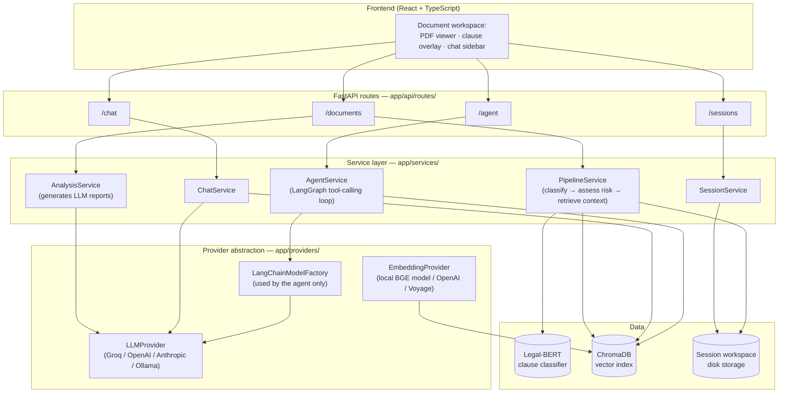
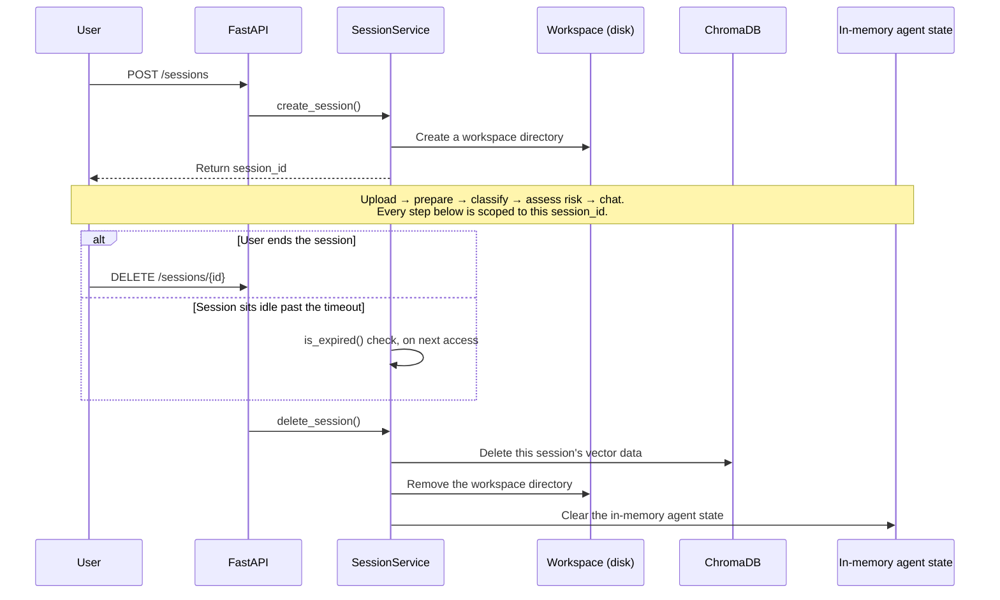

# Architecture

## Principles

- **Routes stay thin.** A FastAPI route does three things only: validate
  the request, call one service, and return the response. A route never
  contains business logic.
- **Services own business logic.** Each service is a single-responsibility
  class — `SessionService`, `PipelineService`, `RiskService`,
  `AnalysisService`, `ChatService`, `AgentService`, and others. Routes
  call into these services; the services do the actual work.
- **Domain models represent pipeline state.** These models are separate
  from both the API request/response shapes and the ML/provider layer. A
  clause moves through four stages as it passes through the pipeline:
  `ExtractedClause` → `ClassifiedClause` → `RiskAssessedClause` →
  `RetrievedClauseContext`. Each stage wraps the previous one. No stage
  mutates the one before it.
- **Providers are swappable.** The LLM (Large Language Model) provider and
  the embedding-model provider each sit behind an interface —
  `LLMProvider` and `EmbeddingProvider`. A config value selects which
  vendor is active (`LLMProviderSource` and `EmbeddingProviderSource`).
  No provider name is hardcoded into a service. The agent layer uses one
  more factory, `LangChainModelFactory`, because LangGraph's tool-calling
  loop needs LangChain's own `BaseChatModel` type, not the app's own
  `LLMProvider` type.
- **Sessions are isolated workspaces.** Every document upload creates its
  own session. Each session gets its own disk directory, its own vector
  index namespace, and its own in-memory agent state. Two concurrent
  users — or two concurrent documents from the same user — never share
  state.

## System diagram



## Session lifecycle

A session is the unit of isolation in ClauseGuard. One session holds:
one uploaded document, one workspace directory, one vector-index
namespace, and one slice of in-memory agent state.

A session ends in one of two ways: the user ends it explicitly, or it
sits idle past a timeout. Both paths run the exact same cleanup.



## Directory layout (private repo)

```
backend/
  app/
    api/routes/       # thin FastAPI routes
    api/deps.py        # shared route dependencies (get_session, validate_document)
    core/               # config, enums, exceptions, risk rules, Chroma client
    domain/             # pipeline-stage dataclasses
    providers/           # LLM / embedding provider abstraction + factories
    schemas/             # Pydantic request/response models + mappers
    services/             # business logic
    prompts/               # Jinja2 prompt templates
  ml/
    training/           # dataset, tokenizer, model, metrics, train loop
    scripts/             # preprocess / train / evaluate / calibrate entry points
    inference/           # classifier loader + predictor used by the running app
    data/, models/, reports/   # gitignored, versioned by CLAUSE_CLASSIFIER_VERSION (v1/ v2/)
frontend/
  src/
    app/                 # shell, layout
    core/api/             # typed API client
    features/               # document, clause, chat, reports, session, pdf, settings
    components/               # shared/reusable UI components
    theme/, styles/             # single-source-of-truth design tokens (see design philosophy)
    lib/                     # hooks, shared utilities
```
