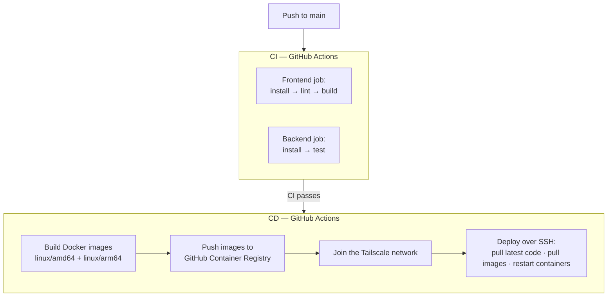
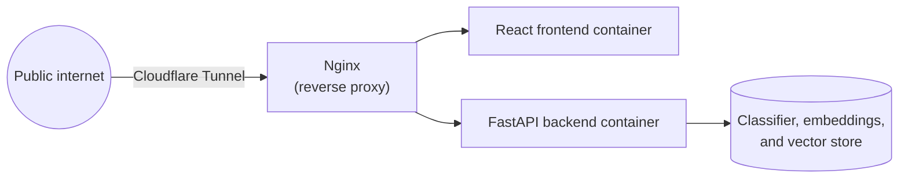
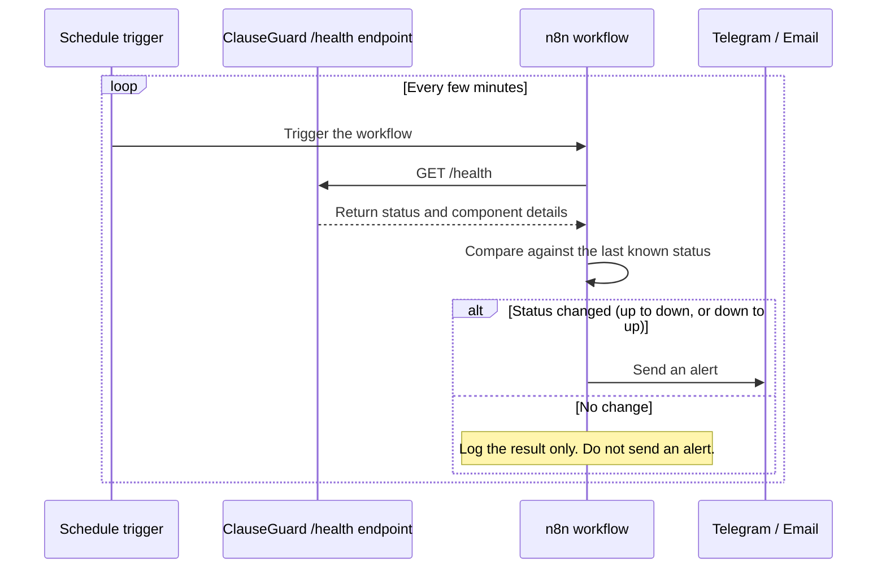

# Deployment & Monitoring

ClauseGuard is self-hosted. It does not run on a managed cloud platform.

A GitHub Actions pipeline builds and ships every merged change automatically.
A separate monitoring workflow watches the live application from outside.
This document explains both.

## Principles

- **Push to deploy.** Merging to the main branch is the only manual step.
  Build, test, image publishing, and deployment all happen automatically
  after that.
- **No public inbound ports.** The application host has no ports forwarded
  on its network. It has no static public IP address either. All public
  traffic goes through Cloudflare Tunnel. Cloudflare Tunnel is a service
  that lets a server receive internet traffic without opening any inbound
  port — the server connects *out* to Cloudflare, not the other way
  around. All administrative access (SSH, deployment) goes through
  Tailscale instead of the public internet. Tailscale is a private
  network built on WireGuard, a fast, modern VPN protocol.
- **Monitoring lives outside the thing it monitors.** The monitoring
  workflow runs on a separate host from the application. If the
  application host goes down, the monitor is still up to detect and
  report it.

## CI/CD pipeline

CI/CD stands for Continuous Integration / Continuous Deployment. CI checks
every change automatically. CD ships every change that passes CI,
automatically.



CI and CD are two separate GitHub Actions workflows.

CD only runs after CI passes. This means a change that fails its own tests
is never built or deployed.

The frontend and backend CI jobs run at the same time, not one after the
other:
- **Frontend job**: install dependencies, lint the code, then build it.
- **Backend job**: install dependencies, then run the automated test
  suite.

The CD pipeline has two stages:

1. **Build and publish.** CD builds the backend and the frontend as Docker
   images. It builds each image for two CPU architectures at once
   (`linux/amd64` and `linux/arm64`) using Docker Buildx, a
   multi-platform build tool. It then pushes both images to the **GitHub
   Container Registry (GHCR)** — GitHub's own image registry. This reuses
   the same authentication token GitHub Actions already has, so no extra
   registry account is needed.
2. **Deploy.** The deploy job joins the same Tailscale network the
   application host is on. It then connects to the host over SSH and
   pulls the new images, then restarts the containers. No SSH port is
   ever exposed to the public internet for this step.

## Application hosting

The application runs on one self-hosted Linux server, called **the
application host** in this document. Every service on it runs inside a
Docker container. Docker Compose manages those containers together.



Two services handle all access to the application host:

- **Cloudflare Tunnel** handles public traffic. The host opens an outbound
  connection to Cloudflare. Because the connection is outbound, no inbound
  port needs to be open on the host's firewall or router, and no static IP
  address is needed.
- **Tailscale** handles administrative access — SSH and deployment. The
  host's SSH port is never exposed to the public internet.

## Health endpoint

The backend exposes one endpoint for health checks: `GET /health`. This
endpoint reports the status of each major component, not just a single
"up" or "down" flag:

```json
{
  "status": "healthy | degraded | unhealthy",
  "components": {
    "classifier": { "status": "ok", "detail": "loaded" },
    "embedding_model": { "status": "ok", "detail": "loaded" },
    "vector_store": { "status": "ok", "detail": "N clauses indexed" },
    "llm_provider": { "status": "ok", "detail": "configured" }
  }
}
```

The endpoint is deliberately cheap to call. It checks that each component
is already loaded — it does not run a real classification or generate a
real AI report. This matters because the monitoring workflow below calls
this endpoint on a fixed schedule, not just when a person is debugging.

## External monitoring

**n8n** is a workflow-automation tool — it lets you build automated,
scheduled tasks without writing a full application. ClauseGuard uses one
n8n workflow to monitor itself.

This workflow runs on its own AWS EC2 instance, called **the monitoring
host** in this document. The monitoring host is joined to the same
Tailscale network as the application host, but it is a separate machine.
It polls the live application on a schedule and sends an alert whenever
the application's status changes.



Two design choices matter here:

- **The workflow reports state *changes*, not every check.** A single
  transient failure does not trigger an alert. A genuine outage triggers
  one alert. Its later recovery triggers exactly one more alert. This
  keeps the alert channel useful instead of noisy.
- **An LLM step writes the alert text.** Instead of sending raw JSON, a
  small language-model step (using Groq, an LLM inference provider)
  rewrites the health-check result as a short, readable status update.

Running the monitor on a separate host from the application is
deliberate. If the application host goes down, the monitor is still
running and can still report it.

## Infrastructure summary

| Layer | Technology |
|---|---|
| Source control / CI / CD | GitHub, GitHub Actions |
| Containerization | Docker, Docker Compose, Docker Buildx (multi-platform builds) |
| Container registry | GitHub Container Registry (GHCR) |
| Application host | Self-hosted Linux server |
| Public ingress | Cloudflare Tunnel |
| Admin / deploy access | Tailscale |
| Monitoring host | AWS EC2 (separate machine from the application host) |
| Automation / alerting | n8n |
| Alert channels | Telegram and Email |
