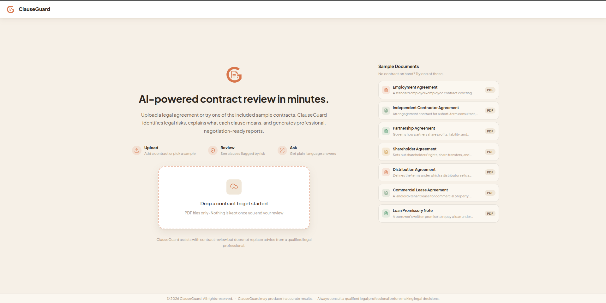
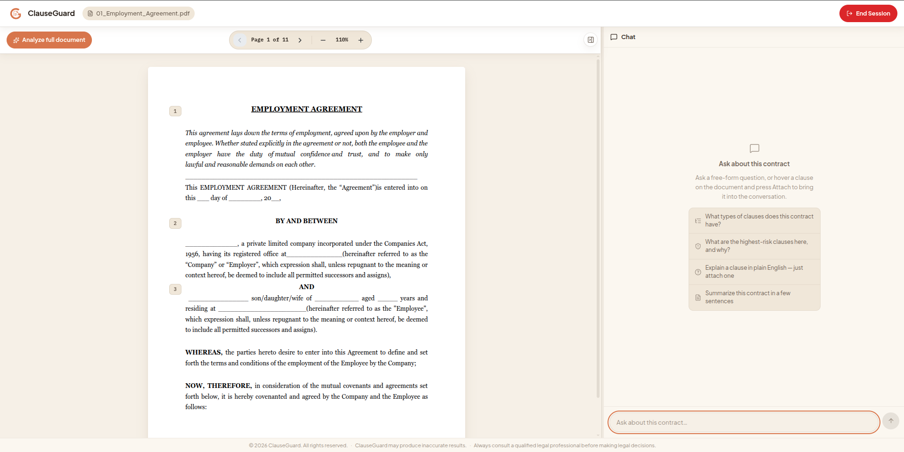
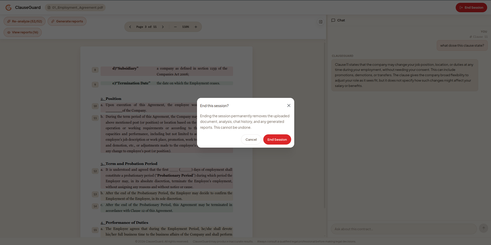

# Gallery

A walkthrough of ClauseGuard end to end, in the order a real session
happens: upload → review → risk analysis → reports → chat → close out.

## Upload

Start from a blank workspace, drop in a PDF, or pick one of the bundled
sample contracts if you don't have one on hand.

## Review the document

Once uploaded, the contract renders as a real PDF. Clause numbers are
anchored to their exact position on the page — this is not a re-flowed
text dump. The chat sidebar offers a few quick-start prompts from the
start, instead of showing a blank box.

## Risk analysis

Running analysis classifies every clause and color-codes it by risk
level directly on the document, so risk is visible at a glance before
you read a single report. See [`PIPELINE.md`](PIPELINE.md) for how a
risk level is actually derived.

## Reports

Generate a report for a single clause directly from the document — the
button reads **Generate report**, then turns into **View report** once
it's ready, opening a popup scoped to just that clause with its own
download button. Or generate a full report for every clause at once — or
just the ones flagged high or medium risk — in one pass, with live
per-clause progress.

Each report breaks a clause down into a plain-language summary, its
legal effect, concrete risks, and specific negotiation points. Reports
can be exported individually, or all together as one combined PDF.

## Chat

Ask free-form questions about the contract, or attach a specific clause
to ask about it directly. Responses stream in as they're generated.

The chat agent can also reason across the whole document, not just one
clause. Here, it's asked to break down every clause type present and how
many of each appear — pulling structured data out of a 52-clause
contract.

See [`AGENT.md`](AGENT.md) for how the underlying tool-calling agent
decides when to look something up versus when to ask for confirmation
first.

## Ending a session

Every session is disposable by design — nothing persists once you're
done. Ending a session is a deliberate, confirmed action since it
permanently discards the uploaded document, analysis, and chat history.

