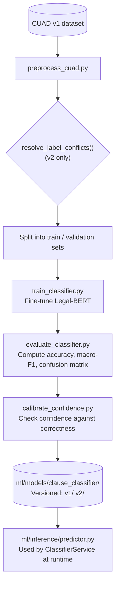

# Clause Classifier

ClauseGuard's clause classifier is a Legal-BERT model. BERT (Bidirectional
Encoder Representations from Transformers) is a widely used
transformer-based language model architecture; Legal-BERT is a version
pre-trained on legal text. This classifier is fine-tuned on
[CUAD](https://www.atticusprojectai.org/cuad) — the Contract Understanding
Atticus Dataset, a public dataset of annotated contract clauses.

The classifier sorts each extracted clause into one of 41 categories. The
deterministic risk engine then maps each category to a risk level (see
[`PIPELINE.md`](PIPELINE.md)).

This document covers the retrain from version 1 (v1) to version 2 (v2) of
the classifier. The debugging story behind that retrain shows how the
model was actually validated — not just trained.

## Pipeline

The folders `ml/data/`, `ml/reports/`, and `ml/models/` are all excluded
from version control (gitignored). Each is versioned instead by the
`CLAUSE_CLASSIFIER_VERSION` setting, into `v1`/`v2` subfolders. This
matters: a retrain run without that versioning discipline would silently
overwrite the previous version's data and reports, since none of it is
tracked in Git.

## v1 → v2: root cause and fix

v1 looked reasonable at a glance: 79% accuracy. But its macro-F1 score
was only 0.63. Macro-F1 averages the F1 score across all classes equally,
so it does not let a few large, easy classes hide poor performance on
smaller ones. Four classes scored **0.00 F1** outright: `Uncapped
Liability`, `Notice Period To Terminate Renewal`, `Irrevocable Or
Perpetual License`, and `Unlimited/All-You-Can-Eat-License`.

The cause was not model capacity. It was a data problem, with two parts:

- **Label conflicts.** CUAD allows a single clause span to answer
  multiple category questions at once. But the training pipeline trained
  a single-label classifier — one that must pick exactly one category per
  clause. As a result, **1,457 clause texts** in the training set were
  attached to two or more contradictory labels. Each of these texts
  taught the model two different "correct" answers for the same input.
  One confusion had real product impact: the model classified
  `Exclusivity` (a HIGH-risk category) as `License Grant` (a MEDIUM-risk
  category) roughly 23% of the time. Every other confusion pair happened
  to land inside the same risk bucket already — so this was the one
  confusion that could silently understate risk to a user.
- **Checkpoint selection bug.** Training selected its best checkpoint by
  raw accuracy, even though macro-F1 was already being computed
  alongside it. Across a 41-class set — ranging from 511 examples for
  `Parties` down to 6 examples for the rarest class — optimizing for raw
  accuracy actively rewards ignoring the rare classes.

**The fix had three parts:**

1. Added `resolve_label_conflicts()`. For any clause text with two or
   more conflicting labels, this function keeps whichever label is
   globally rarer across the dataset, and drops the rest. This is a
   data-driven tie-break, not a hand-authored legal judgment call — the
   more common label in each colliding pair already has plenty of
   unambiguous examples to learn from elsewhere. The function only
   touches genuinely conflicting texts; legitimate repeated boilerplate
   under one consistent label is left untouched.
2. Changed the checkpoint-selection metric from `"accuracy"` to `"f1"`
   (`metric_for_best_model="f1"`).
3. Added class-weighted cross-entropy loss, using scikit-learn's balanced
   class weights, through a `WeightedLossTrainer` class that overrides
   `compute_loss`.

## Results

| Metric | v1 | v2 |
|---|---|---|
| Accuracy | 0.79 | 0.86 |
| Macro precision | 0.71 | 0.83 |
| Macro recall | 0.63 | 0.77 |
| Macro F1 | 0.63 | 0.78 |

All four previously-0.00-F1 classes now score well — for example,
`Uncapped Liability` went from 0.10 to 0.76 F1. The `Exclusivity` →
`License Grant` confusion is essentially eliminated.

A larger multi-label rework was considered and deliberately not pursued.
The data-conflict fix closed the gap that actually mattered.

## Confidence calibration, not just accuracy

Classification confidence feeds directly into the risk engine's
low-confidence flag. Because of this, confidence needed to be checked
against real data, not simply trusted as accurate.

`calibrate_confidence.py` buckets v2's validation predictions by
confidence level, then checks whether higher confidence actually predicts
higher correctness. It does, in aggregate: accuracy is 88% for
predictions above the 0.50 confidence cutoff, and 38% below it — a
genuine, and fairly consistent, separation. The 0.50 cutoff is stored as
a config value, `CLASSIFIER_LOW_CONFIDENCE_THRESHOLD`, rather than a
hardcoded number inside `risk_service.py`. The calibrated cutoff value
itself did not need to change from 0.50.

One class-level exception is documented rather than engineered around:
`Effective Date` shows *inverted* calibration. Its accuracy is 80% for
predictions *below* the threshold, and only 21% above it — the model is
confidently wrong specifically for this field, which traces back to its
confusion with a similar category, `Agreement Date`. This exception does
not corrupt any risk-level output, because both `Effective Date` and
`Agreement Date` map to the same `LOW` risk bucket. It only makes the
confidence flag less meaningful for that one field. A per-class threshold
was considered and rejected: with as few as 10–15 validation examples for
some classes, a per-class threshold risked overfitting to noise.
