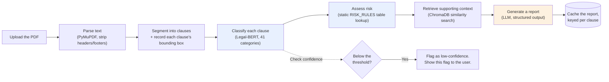
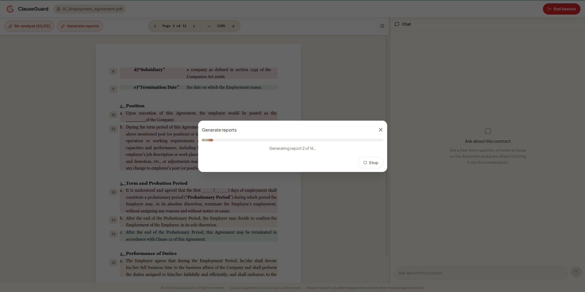
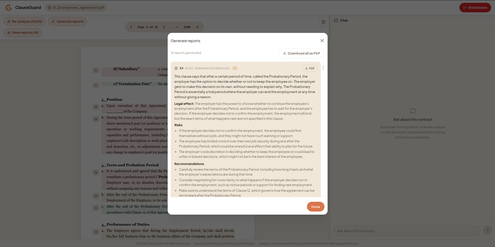

# Clause Analysis Pipeline

Every uploaded document moves through the same pipeline before any LLM
(Large Language Model) is involved. Classification and risk assessment
are both deterministic — the same input always produces the same output,
and each result can be traced back to a rule. The LLM only enters at two
later stages: generating a report, and answering chat questions. Even
then, the LLM explains results the pipeline already produced. It never
invents a risk level itself.

## Stages

1. **Upload.** The PDF is stored in the session's workspace. No analysis
   happens yet.
2. **Parse.** The backend extracts text from the PDF, page by page, using
   PyMuPDF (a PDF-processing library). It then strips running headers and
   footers using layout-aware detection. This is more reliable than
   matching repeated text, which breaks when a document's title also
   happens to be its running header.
3. **Segment.** The cleaned text is split into individual clauses. Each
   clause keeps a record of its exact position on the page (its
   constituent line rectangles). This lets the frontend draw an exact
   bounding box around the clause on the PDF — not an approximate one.
4. **Classify.** Each extracted clause goes through the fine-tuned
   Legal-BERT classifier (see [`ML.md`](ML.md)). BERT (Bidirectional
   Encoder Representations from Transformers) is a widely used
   transformer-based language model architecture; Legal-BERT is a version
   fine-tuned on legal text. Classification produces a predicted clause
   category and a confidence score. The confidence score is checked
   against a calibrated threshold. If it falls below that threshold, the
   clause is flagged as low-confidence instead of being silently trusted.
5. **Assess risk.** The clause's category is looked up in a static rules
   table (`RISK_RULES`, in `app/core/risk_rules.py`). This lookup produces
   a risk level — `LOW`, `MEDIUM`, or `HIGH` — plus the specific rule-based
   reasons behind that level. No LLM call happens in this step. Because
   the lookup is a fixed table, the same classification always produces
   the same risk level.
6. **Retrieve context.** The clause is converted into an embedding (a
   numeric representation of its meaning) and used to search the
   session's ChromaDB vector index. This search finds supporting passages
   elsewhere in the same document.
7. **Generate report (on demand).** This step only runs when a report is
   requested — not automatically for every clause. The backend builds a
   prompt from the retrieved context using Jinja2 templates, then calls
   the LLM provider. The LLM returns a structured report with five parts:
   a summary, the legal effect, concrete risks, recommendations, and
   negotiation points. Each part is prompted separately to stay in plain
   language, not legal terminology.
8. **Cache.** Once a report is generated, it is cached per clause.
   Re-viewing or re-referencing that clause later — including from chat —
   reuses the cached report instead of calling the LLM again.

## Flow

The blue stages (Classify, Assess risk) are fully deterministic. The
orange stage (Generate report) is the only stage that produces
LLM-generated content — and it is generated *from* the deterministic
stages' output, not independently of them.

Classification and risk assessment render directly on the document as
soon as they finish running. Every clause is color-coded by risk level
immediately — the result is not buried in a separate results view:

Reports can be generated one clause at a time, or in bulk for many
clauses at once, filtered by risk level. Bulk generation shows live,
per-clause progress:

A single clause can also be generated and reviewed on its own, directly
from its position on the document — the overlay's **Generate report**
button turns into **View report** once the report exists, opening a
popup scoped to just that clause with its own download button.

## Full-document analysis and self-healing

A user, or the chat agent (through its `request_full_document_analysis`
tool — see [`AGENT.md`](AGENT.md)), can trigger classification and risk
assessment for every clause in the document at once, instead of one
clause at a time.

Individual clause reports can also be requested out of order. If a
clause has not yet been classified or risk-assessed when its report is
requested, `PipelineService` runs the missing steps first automatically.
It does not fail and ask the caller to run them manually. This means the
pipeline's stage-by-stage structure never needs to be orchestrated by
hand from outside the service.
